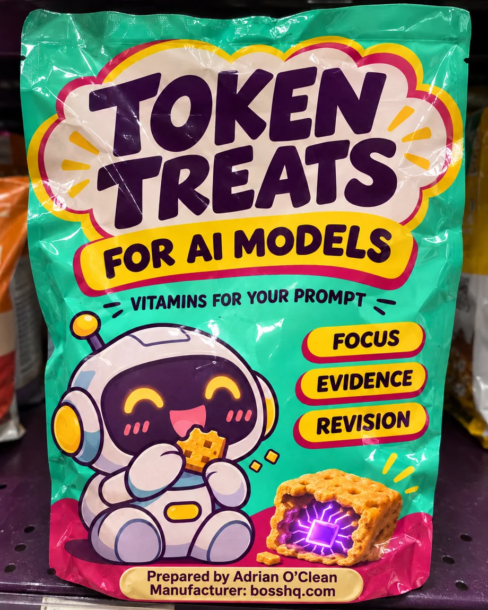

# AI Vitamins

Prepared by Adrian Rowley.

> **Experiment. No performance guarantee.** The checklist and virtual treat may improve, worsen or leave an answer unchanged. Test them on your own tasks and verify important outputs against the source material.

AI Vitamins gives a model a short method for checking assumptions, assessing sources and revising its work. The optional Token Treat is a virtual biscuit awarded after a reviewer scores the answer.

## Choose your model

| Guide | How it handles the task |
| --- | --- |
| [Claude AI Vitamins](models/claude.md) | Uses tagged documents, a clear task and short evidence excerpts when useful. |
| [Gemini AI Vitamins](models/gemini.md) | Labels files, tables and images and asks for page, section or timestamp references. |
| [DeepSeek AI Vitamins](models/deepseek.md) | Uses a short decision template and scores the final answer in a fixed thinking mode. |
| [ChatGPT AI Vitamins](models/chatgpt.md) | Uses direct success criteria, a source block and a concise output request. |
| [AI Vitamins for other models](models/other-models.md) | Provides a plain-text prompt for Copilot, Llama, Mistral and other chat models. |

In a client that loads [Agent Skills](https://agentskills.io/specification), import the whole `token-treats` folder. In a regular chat, copy the prompt from your model guide.

## Try it

1. Open [the market shuttle task](references/task-market.md) and [the four prompt versions](references/condition-blocks.md).
2. Run each version in a fresh chat. Use the same model, settings and source packet. Use the canonical prompt blocks for each version, including when you repeat the experiment on another model.
3. Shuffle the answers, hide the labels and use [the scorecard](references/scorecard.md). Compare B with A and D with C for the treat promise. Compare C with A for the checklist alone.

[Experiment and award protocol](references/experiment.md) · [Second practice case](references/task-library.md) · [First pilot](references/pilot.md) · [Research](references/research.md) · [Authoring notes](references/authoring.md)
